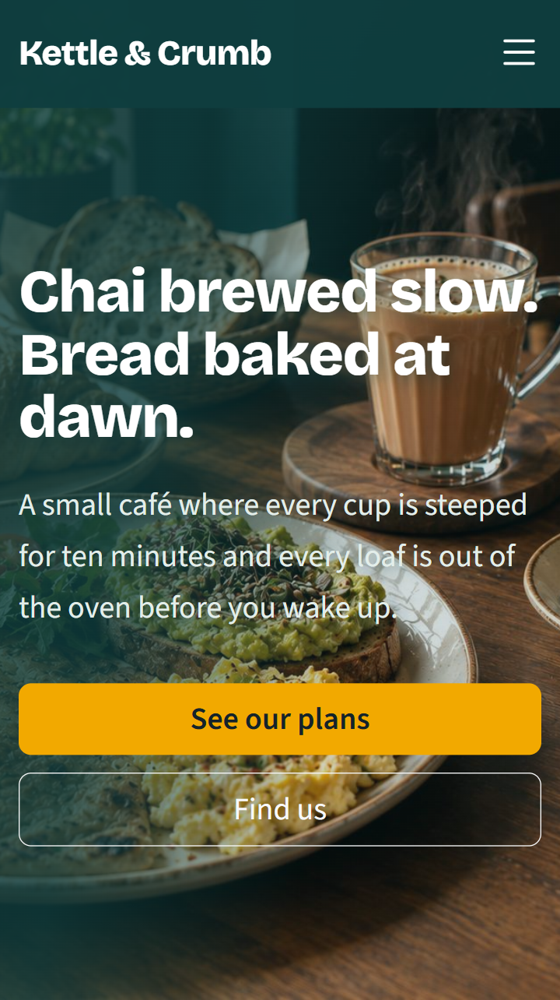
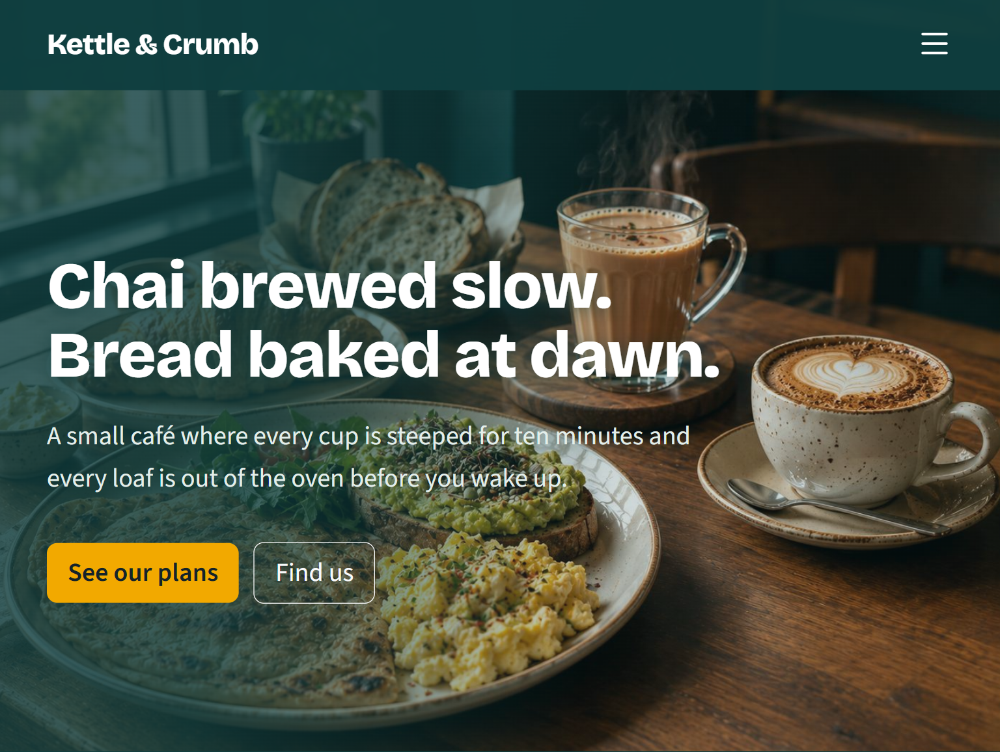
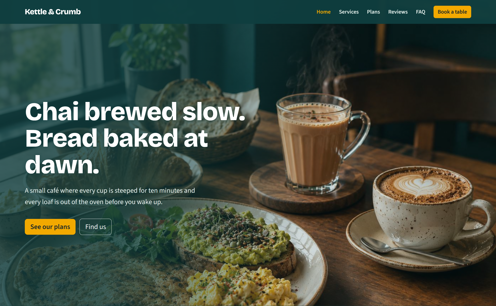

# Kettle & Crumb Café: Responsive Business Landing Page

**The Sky Gen, Web Development, Project 02 (Beginner)** | Ref: TSG/WD/P02/2026

- Live site: https://tsg-webdev-p02-unaisah-najam.vercel.app/
- Repository: `<paste GitHub URL>`

## Business concept
Kettle & Crumb is a fictional neighbourhood café in Gujranwala that serves slow-brewed chai, specialty coffee and fresh bakes. The page is built to turn visitors into customers: it opens with a hero and call-to-action, shows the services, offers monthly café plans, builds trust with reviews, answers doubts in an FAQ, and ends with a booking form and map.

## Features
- Sticky navbar with smooth scrolling and active-link highlight (Bootstrap ScrollSpy)
- Hero section with background image, headline, sub-headline and two call-to-action buttons
- Services section with six cards, icons and hover effects
- Pricing table with three plans and a highlighted recommended plan
- Testimonials slider with three reviews, previous/next arrows, dots and auto-play (vanilla JavaScript)
- FAQ accordion with five questions, one open at a time (vanilla JavaScript)
- Contact form with validation and an embedded Google Map
- Footer with business info, quick links and social icons
- Fully responsive at three breakpoints (mobile, tablet, desktop) with a working hamburger menu

## Tech stack
HTML5, CSS3, JavaScript (vanilla), Bootstrap 5.3, Bootstrap Icons, Google Fonts, Git & GitHub, Netlify/Vercel, Google Maps Embed, Chrome DevTools, Lighthouse.

## How the JavaScript works
- **Slider:** a `show(n)` function toggles the `active` class on one slide at a time. The dots are created from the number of slides, and a timer advances the slide every 6 seconds.
- **Accordion:** clicking a question closes every answer, then opens the clicked one unless it was already open. The open state is stored in `aria-expanded`.
- **Contact form:** on submit, each field is checked with `checkValidity()`. Invalid fields get Bootstrap's `is-invalid` class, which shows the error message under them.
- **Mobile menu:** Bootstrap's collapse closes the menu after a link is tapped.

## Folder structure
```
index.html
css/style.css
js/main.js
images/          (hero.jpg)
screenshots/     (mobile, tablet, desktop)
reports/         (Lighthouse report)
```

## Screenshots
| Mobile (360px) | Tablet (768px) | Desktop (1440px) |
|---|---|---|
|  |  |  |

## Lighthouse report
Performance: 96 | Accessibility: 93 | Best Practices: 100 | SEO: 100
Tested on mobile against the live Vercel deployment. See `reports/lighthouse.pdf`.

## Credits
- Hero image: AI-generated with ChatGPT, October 2026
- Icons: Bootstrap Icons (MIT)
- Fonts: Bricolage Grotesque and Source Sans 3 (Google Fonts, OFL)
- CSS framework: Bootstrap 5 (MIT)

## Author
Unaisah Najam
